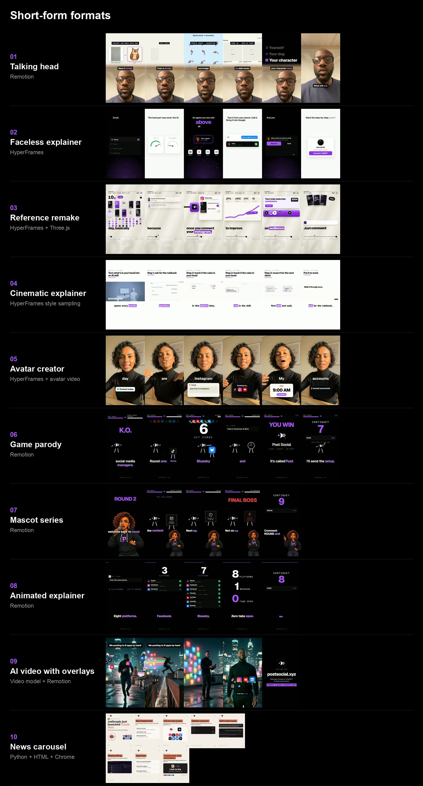

# Short-form formats

A kit for making short-form videos and carousels that hold attention: ten formats tested on real TikTok and Instagram accounts, with step-by-step guides, runnable starters and the design, motion and sound rules behind them. Point it at your own brand kit and every format comes out in your colours, fonts and voice.



## What's inside

| Folder | What it holds |
|---|---|
| `brand/` | `brand.json`, your brand kit (colours, fonts, logo, voice, CTA, banned phrases). Everything reads it. |
| `formats/` | One guide per format: what it is, when to use it, the steps, and what we learned. |
| `shared/` | Rules every format follows: brand and look, script and captions, voice, sound design, motion language, covers, posting checklist, reference intake, testing. |
| `starters/` | Runnable projects you copy: a Remotion kit, a HyperFrames explainer and a carousel generator. |
| `tools/` | Small scripts: transcribe with word times, cut silences, loudness, phone copies, contact sheets, frame strips. |
| `examples/` | Frames and covers from real pieces made with these formats. |
| `references/` | A template for your reference library. |

## Pick a format

| Format | What it looks like | Built with | Starter |
|---|---|---|---|
| [Talking head](formats/talking-head.md) | You on camera; face, split and full-graphic layouts switch on spoken words | Remotion | `remotion-kit` |
| [Faceless explainer](formats/faceless-explainer.md) | Word-by-word script, slam words, animated UI cards | HyperFrames | `hyperframes-explainer` |
| [Reference remake](formats/reference-remake.md) | Your version of a reel that works, matching its look, motion and sound | HyperFrames + Three.js | `hyperframes-explainer` |
| [Cinematic explainer](formats/cinematic-explainer.md) | A 2:1 concept film plus a vertical cut | HyperFrames style sampling | — |
| [Avatar creator](formats/avatar-creator.md) | A UGC-style creator selfie video with pop-up cards | HyperFrames + avatar video | — |
| [Game parody](formats/game-parody.md) | Your product fights a chore, fighting-game style | Remotion | `remotion-kit` |
| [Mascot series](formats/mascot-series.md) | Repeatable episodes with a brand character | Remotion | `remotion-kit` |
| [Animated explainer](formats/animated-explainer.md) | Team, counter, news and listicle reels with real screenshots | Remotion | `remotion-kit` |
| [AI video with overlays](formats/ai-video-overlay.md) | Cinematic AI shots with designed title bars and icon pops | Video model + Remotion | `remotion-kit` |
| [News carousel](formats/news-carousel.md) | 7–10 slide photo carousels for launches and how-tos | Python + HTML + Chrome | `carousel` |

## Quick start

1. **Clone and set your brand**
   ```bash
   git clone <repo-url> short-form-formats && cd short-form-formats
   ```
   Edit `brand/brand.json` and replace `brand/logo.svg`. [ADAPT.md](ADAPT.md) walks through it.
2. **Install what your formats need**
   - Python 3.10+ with `pip install pillow numpy faster-whisper`
   - ffmpeg
   - Node 18+ for Remotion and HyperFrames
   - Google Chrome for carousels and screenshots
3. **Render a sample** from a starter, following its README:
   - [starters/carousel](starters/carousel/README.md)
   - [starters/remotion-kit](starters/remotion-kit/README.md)
   - [starters/hyperframes-explainer](starters/hyperframes-explainer/README.md)
4. **Make your first real piece** with the format guide, then run the [posting checklist](shared/posting-checklist.md).

## The ideas that matter most

- **Key every visual to a spoken word.** Transcribe with word times and place every beat on a word, never by hand.
- **Dense beats sparse.** A new visual every 1–2 s in talking heads, every 2–4 s in faceless explainers, about 2 s for each animation to read.
- **One cue on every motion.** Sound is half of why a dense edit feels finished.
- **Real logos and real UI.** Screenshots with a camera move and a highlight beat redrawn mock-ups.
- **One accent colour.** Restraint makes it look designed.
- **Your product is the helper, not the hook.** Lead with the news, the pain or the contrarian line.
- **Copy the craft of a reference, never its content.**

## Make it yours

Read [ADAPT.md](ADAPT.md): set your brand kit, pick two or three formats, change the pacing and platform rules to match your numbers, and add your own formats as they work.

## Use with Claude Code

This repo is also a Claude Code skill (`SKILL.md`). Clone it into `~/.claude/skills/short-form-formats` and ask for "a faceless explainer about X" or "remake this reel: <link>".
