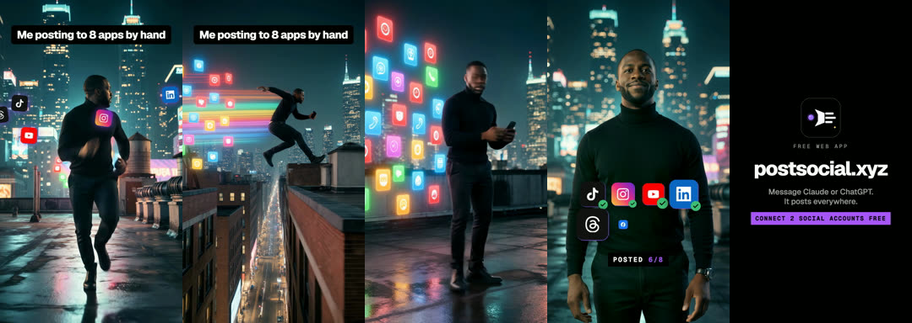
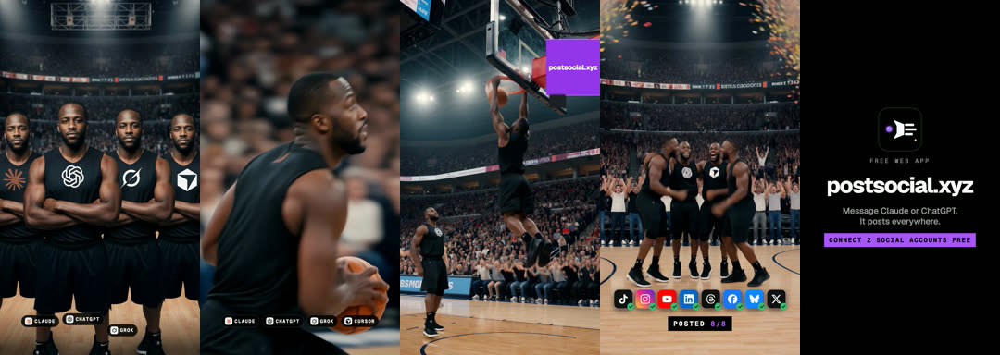
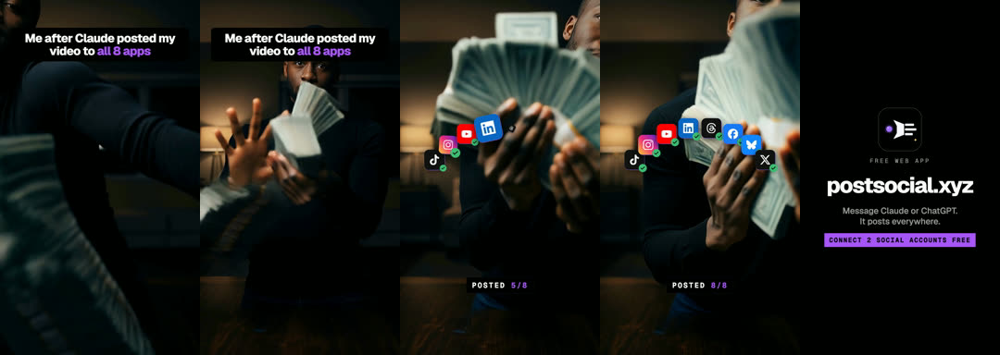

# AI video with overlays

**What it is:** short cinematic AI-generated shots (3 s each) with designed overlays on top: a title bar with one accent phrase, app icons popping with ticks, a roster, your URL.
- **Chase scene:** five shots: run, leap, panic, stop and type, win.
- **Team game:** a clone team plays a sport; jerseys carry tool logos.
- **Trend recast:** you, recast into a trending clip's motion. The source clip is never shown.

**Use it when:** you have a video-model budget and want a cinematic hook.

**Built with:** an image-to-video model (for example Kling) for shots, and Remotion for overlays (`starters/remotion-kit`).

## Steps
1. Shot list (3 s per shot) and the title bar line.
2. Generate the shots from reference photos of yourself.
3. Drop the clips into `public/` and build the overlays (title bar, icon pops, counter, end card).
4. Render, normalise, and make a photo cover from a raw frame (not the final render, or the title bar appears twice).

## Rules
- Turn on the AI-generated content label.
- Only recast your own likeness. Never a real person's without written permission.
- Don't show or reuse the source trend clip.
