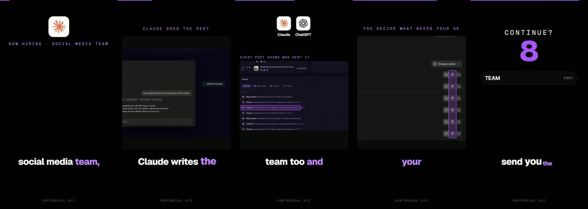
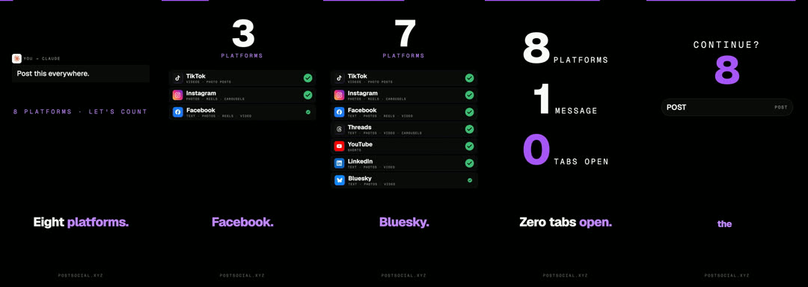
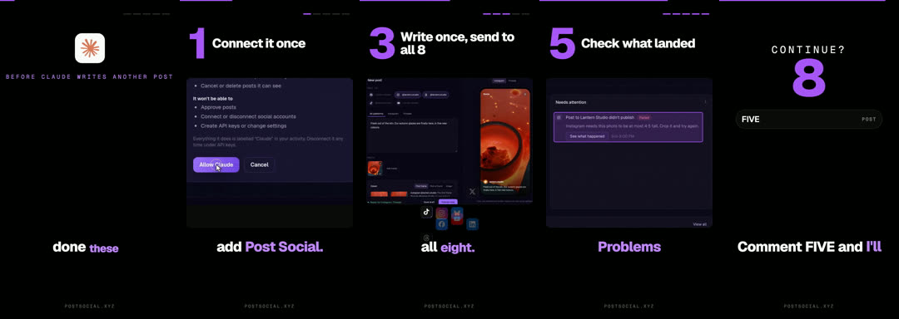

# Animated explainer (no face, no mascot)

**What it is:** four repeatable animated formats in your brand look (one accent colour, a new beat every 1–2 s), mixing real screenshots and clips with animated parts and a narrator:
- **Team:** "I gave [tool] a team": staff badges flip from HIRED to DONE.
- **Counter:** "One action, N results": a big counter ticks while cards slam into a stack.
- **News:** a reaction to a headline: the real headline, an orbit of logos, the docs page.
- **Listicle:** "5 things before you…": a giant numeral per step with a real UI crop.

**Use it when:** explaining a feature, a number, a news hook or a checklist without filming.

**Built with:** Remotion. **Starter:** `starters/remotion-kit` (`Listicle`, `Counter`, plus `Shot`, `BigNumber`, `Orbit`, `StepHeader`).

## Steps
1. **Pick the format** and write the voiceover with what's on screen beside each line.
2. **Voice** with a narrator and transcribe it.
3. **Real material:** screenshots, product clips and logos into `public/`.
4. **Build** the composition from the kit, render and normalise.
5. **Cover** with the composition's own parts in their end state.

## Lessons
- Real screenshots with a slow camera move and a highlight mark beat redrawn UI.
- Only show logos of tools that really work with your product.
