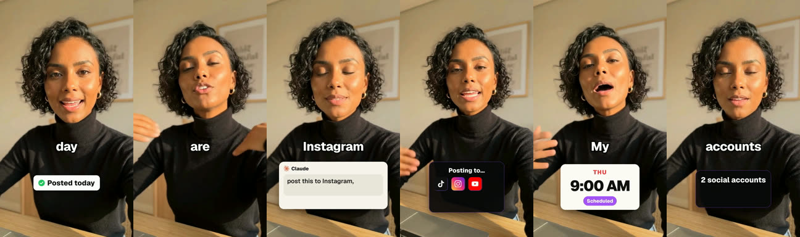

# Avatar creator

**What it is:** an AI avatar of a casual creator at home, framed like a selfie in 9:16. A hook title, three numbered reasons and a CTA, with one-word captions and pop-up cards (real logos, a notes-style ticked list, a fanned stack of app icons). 60–70 s.

**Use it when:** you want a UGC-style creator video without filming yourself.

**Built with:** HyperFrames, with an avatar video from HeyGen (paid credits). Captions and pop-ups are built in HTML, not generated.

## Steps
1. **Script:** a hook line, "three reasons", then the CTA. Write a pop-up table: the line, then what pops up.
2. **Avatar video:** generate the talking avatar from one look image. Plan the credit cost first.
3. **Transcribe** the avatar audio to `words.json`.
4. **Place pop-ups and captions** with word lookups; a missing word stops the build.
5. **Render** and normalise.

## Rules
- Turn on the platform's AI-generated content label.
- Use an avatar you have rights to. Never a real person's likeness without written permission.
