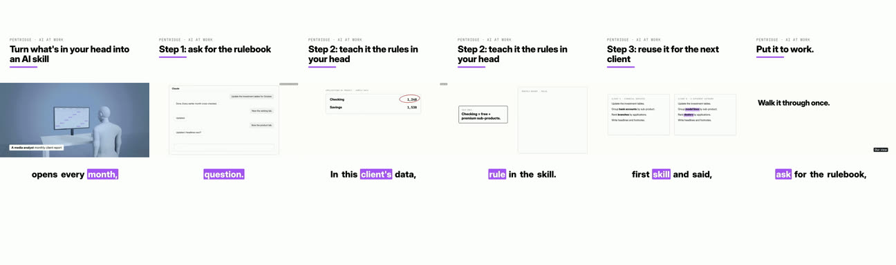

# Cinematic explainer and its vertical cut

**What it is:** a 2:1 concept film (2–3 minutes) with 3D shots, designed boards and a narrated voice, then cut into a 9:16 reel: the film sits in a cropped window, a headline per segment above it, word-by-word captions below.

**Use it when:** a big idea deserves a short film and you have time for several review stops.

**Built with:** HyperFrames style sampling (the `hyperframes` and `style-sampling` skills), plus a small script for the vertical cut.

## Steps
1. **Pick a style template** for the topic (3D brand, animated science, collage).
2. **Script** to the template's skeleton and check the length (about 160 words a minute).
3. **Voice** it (`shared/voice-and-audio.md`), at a calmer speed than a reel.
4. **Storyboard:** draft the shots and boards, then stop and review before rendering.
5. **Render the film** and re-time shots that land late.
6. **Vertical cut:** split the film into segments, write a headline for each, and stack headline, film window and captions in 1080x1920. Keep text inside the safe zone.
7. **Cover** from a strong film frame plus the hook.

## Lessons
- This is the slowest format; plan for several stops.
- One film gives you a long version for YouTube and a vertical cut for Reels and TikTok.
