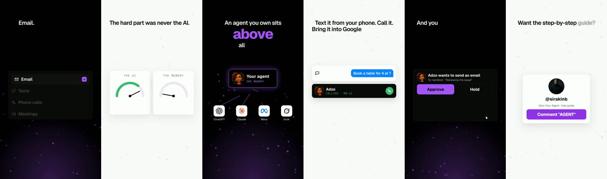

# Faceless explainer (kinetic type and UI cards)

**What it is:** a voice-led reel with no face. The script appears word by word at the top, one key word per line slams in huge in your accent colour, and under each line an animated, simplified UI card proves the point (a list ticks, bars grow, a cursor clicks, a gauge swings). A visual change every 2–4 s, ending on a profile-card CTA. 40–60 s.

**Use it when:** explaining a concept, a guide or a product when you have no footage and don't want to film.

**Built with:** HyperFrames (HTML to video). **Starter:** `starters/hyperframes-explainer`.

## Steps
1. **Script as a table:** line, slam word, card under it. About 14 lines for 50 s.
2. **Voice:** your own read, your cloned voice, or a stock narrator (`shared/voice-and-audio.md`). Transcribe to `words.json`.
3. **Fill `script.json`** and run `python3 gen.py`. Every visible change is keyed to a spoken word. Re-run after any script or timing change.
4. **Check and preview:** `npx hyperframes check`, then preview and render.
5. **Sound** comes from the same script: whoosh, slam, tick and land cues on the motion.
6. **Cover:** the hook on a designed card.

## Adapt it
- Card types are plain HTML and CSS; add your own (a chart, a chat bubble, a product mock) in `gen.py`.
- `--look paper` switches to a cream, serif look; write your own look the same way.

## Lessons
- Whisper splits "step-by-step" and "7pm" into pieces; the starter glues them back.
- A music bed helps this format more than any other; add one quietly under the voice (about 10 dB down) or pick a trending sound in the app.
