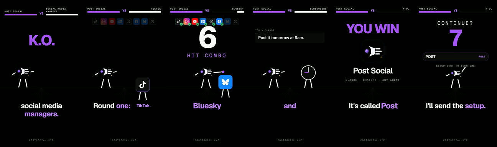
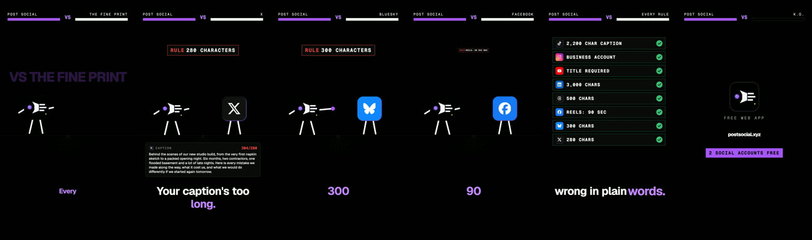

# Game parody (fighting game)

**What it is:** your product (its app icon with simple stroke-drawn limbs) fights a chore your audience hates. The chore's pieces walk in and get knocked out; each hit stamps a "done" badge. Health-bar HUD, combo counter, "FIGHT!" and "K.O." slams. 30–40 s.

**Use it when:** product vs a pain point, told as a joke. It was our best-performing animated reel format.

**Built with:** Remotion. **Starter:** `starters/remotion-kit` (`GameParody`).

## Steps
1. **Pick the enemy** (a chore) and the finishing move (the one action in your product that solves it).
2. **Script the beats:** intro, fight, combo hits, K.O., CTA.
3. **Voice** it and transcribe it.
4. **Timeline:** put every hit on a spoken word. Opponents use real icons where the joke needs them.
5. **Render**, normalise, and make a cover: the HUD bar ("YOUR BRAND vs THE CHORE"), a big title and a hit frame.

## Lessons
- Synthesized hit sounds are enough. Skip music and add a trending sound in the app.
- Keep it short; the joke lands in the first 3 seconds or not at all.
