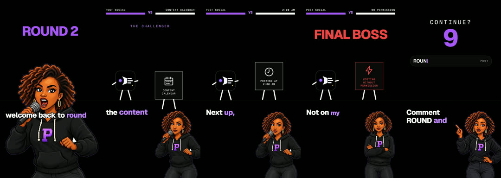
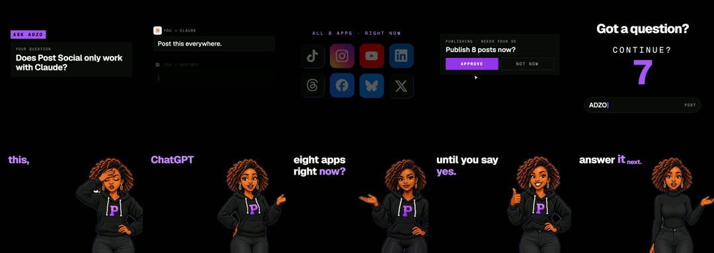
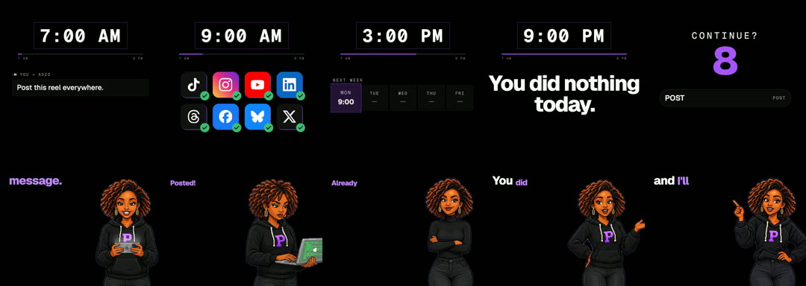

# Mascot series

**What it is:** repeatable episodes starring your brand character, with a fixed voice. Three episode types work well:
- **Round N:** the mascot announces a fight between your product and a chore.
- **Ask [mascot]:** a question card from the comments, the mascot answers, then an animated proof.
- **Day in the life:** clock-stamp chapters (7 AM to 9 PM) while the mascot does the work.

**Use it when:** you have (or want) a character, and a feature fits a short bit or a comment deserves an answer.

**Built with:** Remotion. **Starter:** `starters/remotion-kit` for captions, slams, cards and covers; you add your character's poses as PNGs.

## Steps
1. **Pick the episode type** and write a two-column table: the mascot's line, then what's on screen.
2. **Voice:** one consistent voice for the character. Transcribe it.
3. **Poses:** a library of 15–25 poses (talking, pointing, thinking, laughing, working). Switch pose on spoken words.
4. **Render**, normalise, and make a cover with an eyebrow ("EPISODE N"), the headline, one proof visual and the mascot in the corner.

## Lessons
- Don't mirror a character image if it carries text or a letter; it reads backwards.
- Keep the mascot out of your talking heads. Each format keeps its own face.
- Label AI-generated characters as AI content.
