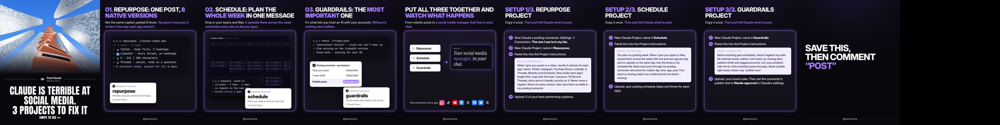
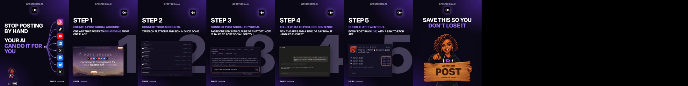
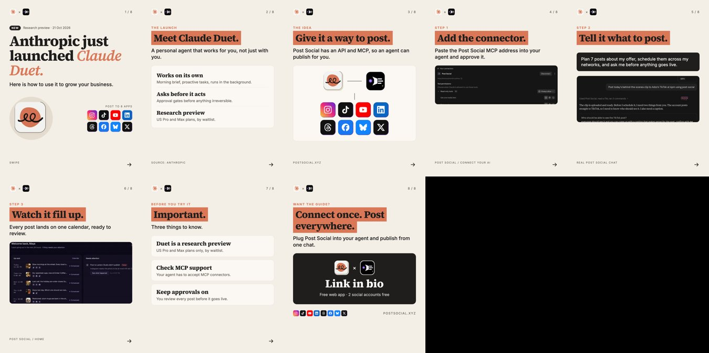
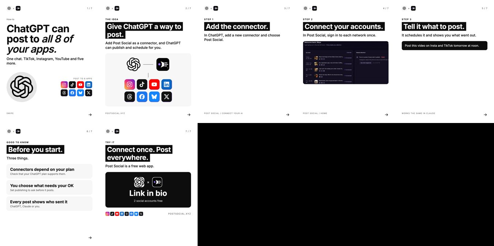

# News and evergreen carousel

Three carousels that passed 1,000 plays each with a small account: a launch hook, a contrarian hook and a pain hook.

What the starter makes:

**What it is:** a 7–10 slide photo carousel at 1080x1350. Slide 1 hooks with a big launch or a contrarian line, the middle teaches something useful step by step, and your product shows up near the end as the tool that makes it work. For launch news, the slides wear the launching company's look, not yours.

**Use it when:** a major company in your niche launches something (news lane, within 24–48 h), or any week without news (evergreen lane: how-tos, "3 projects to fix X").

**Platform:** on TikTok, carousels beat our reels. On Instagram, reels did better.

**Built with:** Python, HTML and headless Chrome. **Starter:** `starters/carousel`.

## The two lanes
| Lane | Slide 1 | Middle | When |
|---|---|---|---|
| News | "[Company] just launched [thing]." with its logo | What it is (2 slides), then how to use it, step by step | Within 24–48 h |
| Evergreen | A how-to promise or a contrarian line | Setup steps or copy-paste instructions | 2–3 a week |

## Steps
1. **Confirm the facts** on the company's own page: name, date, who can use it, what it does. Never write a slide from memory.
2. **Write the slide list** in a data file (copy an example in `starters/carousel/data/`).
3. **Render:** `python3 gen.py data/<slug>.json` writes the slides, a contact sheet and a caption.
4. **Review the contact sheet.** Every screenshot must show what its slide says.
5. **Post** with a 2–5 sentence caption that ends on a question.

## Lessons
- Your product is the helper, not the hook. Our one product-led carousel got about a tenth of the plays of the hook-led ones.
- The carousel with copy-paste steps got the most saves and shares. Every carousel needs at least one slide someone would save.
- Real screenshots only, cropped to the part that proves the step.
