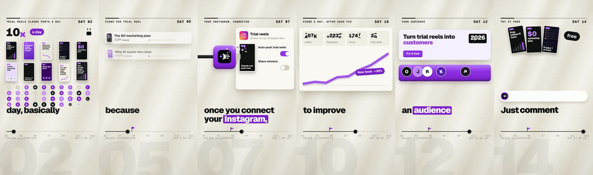
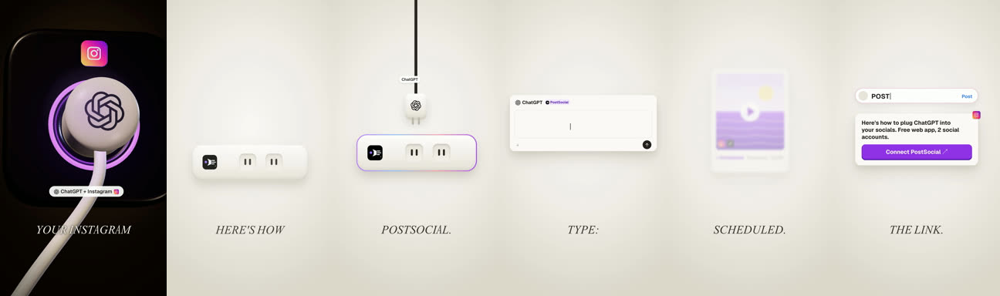

# Reference remake

**What it is:** you find a reel that works and make your own version that **feels** like it: the same palette, motion density and sound design, with your accent colour and your real features. You copy the craft, never the content or the creator's assets.

**Use it when:** you see a format performing in your niche and want to test it with your topic.

**Built with:** HyperFrames, with Three.js for 3D shots. **Starter:** `starters/hyperframes-explainer` (the `paper` look shows how a reference look is rebuilt). Process: `shared/reference-intake.md`.

## Steps
1. **Save the reference** and log it in your reference library (link, creator, what you like, stats if visible).
2. **Break it down:** a frame strip at about 8 fps (`tools/make_strip.sh ref.mp4 strip.jpg 24`), the transcript, and the audio split into voice and background (demucs). Note the look per section, caption style, pace, how far the background sits under the voice, and where it peaks.
3. **Check the claims.** Swap any feature you don't actually have.
4. **Script** to the reference's length and beat count. Voice it and transcribe it.
5. **Build** its motion vocabulary (for example odometer numbers, bar races, cards flying in, debris bursts, highlight boxes behind caption words) and put a sound cue on every motion event.
6. **Render, compare side by side** with the reference and iterate. Expect two or three versions.
7. **Cover:** a designed card or a UI crop.

## Adapt it
- Keep the reference's look; don't force your default brand look onto it. Change only the accent colour and the content.
- No budget for AI video? Build 3D openings in Three.js inside HyperFrames.

## Lessons
- Our first remake restyled the reference into our dark brand look with light motion. It looked flat next to the original. The version that worked copied the density and the soft "thock and click" sound design.
- Never show the reference clip itself or reuse its audio, characters or footage.
