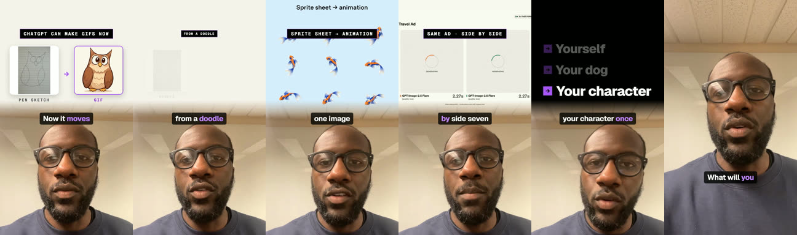
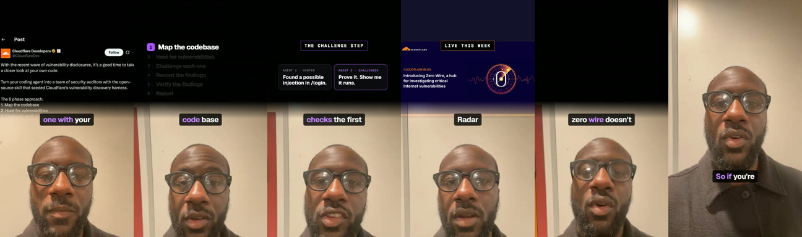

# Talking head (dense edit)

**What it is:** you on camera, edited densely. The layout switches beat by beat between full face, split screen (graphic on top, face below) and a full-screen graphic. Real logos and real product UI, a new visual every 1–2 s, word captions with one accent word, and a short digital tick on every cut. 45–75 s.

**Use it when:** news in your field, a tool review, a hot take, or a product you want to show. It's the best default for a personal brand because your face builds trust and the edit holds attention.

**Built with:** Remotion. **Starter:** `starters/remotion-kit` (`TalkingHead` composition). Tools: `tools/proxy.sh`, `tools/transcribe.py`, `tools/cuts.py`.

## Steps
1. **Script** (see `shared/script-and-captions.md`). Film it on a teleprompter, one take per line or one long take.
2. **Proxy the footage.** iPhone HEVC can crash Remotion: `tools/proxy.sh raw/take.mov public/video/take.mp4`.
3. **Transcribe:** `python3 tools/transcribe.py raw/take.mov raw/words.json`.
4. **Cut the silences:** `python3 tools/cuts.py raw/words.json src/edit.json` (keeps pauses up to 0.5 s).
5. **Collect real visuals:** screenshots at 2x (headless Chrome), real logos (Simple Icons, the brand's press kit), launch clips. Record live UI where you can (typing into the app, menus opening).
6. **Write the beats.** Each beat starts on a spoken word with `at('word', nth)` and picks a mode (face, split or full) and a graphic. A word that isn't in the transcript stops the render with an error, which keeps timing honest.
7. **Sound:** a tick on every cut, a heavier hit on full-screen slams (`shared/sound-design.md`).
8. **Render** (in chunks for long takes: `--concurrency=4 --timeout=120000`), then `tools/loudnorm.sh`.
9. **Cover** with your face and the hook (`shared/covers.md`).

## Adapt it
- Swap the accent colour and fonts in `brand/brand.json`; the captions and graphics follow.
- If your audience prefers calmer edits, raise the beat length to 2–3 s, but keep a change at least every 3 s.
- No teleprompter? Talk freely, then let `cuts.py` remove the gaps.

## Lessons
- Dense beats a clean, sparse card layout every time we tested it. Viewers called sparse versions "slides".
- Give every animation about 2 s. Faster than that and nobody reads it.
- Credit sources in the caption, not as on-screen "via" tags.
- Keep labels away from the top edge (the app's own buttons sit there).
