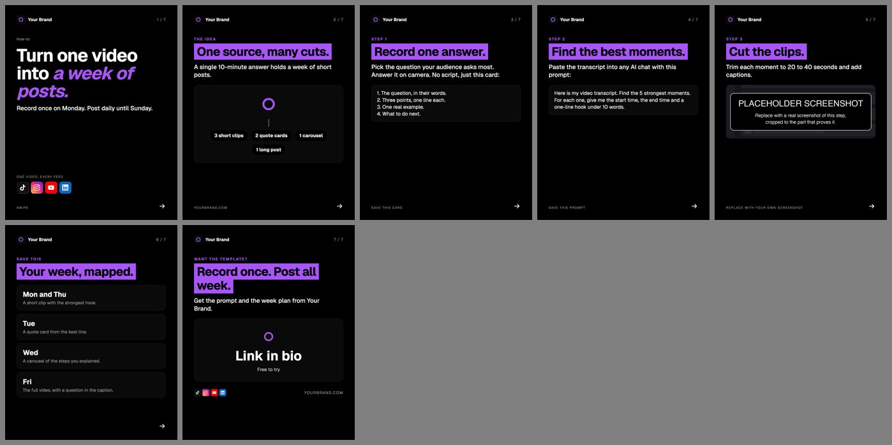
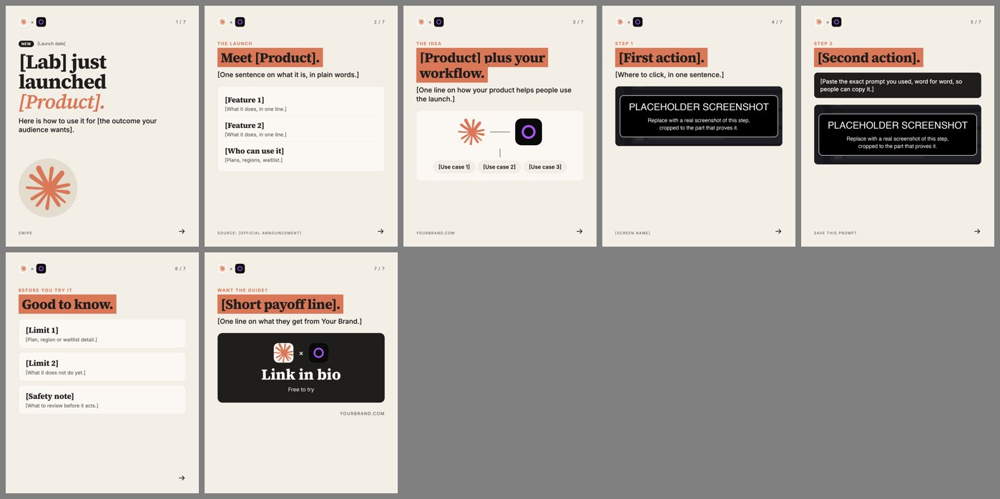

# Carousel starter

Turns a JSON file into a TikTok or Instagram carousel: 1080x1350 PNG slides, a contact sheet to review them at a glance, and a ready caption. Your colors, fonts, logo, url and call to action come from the shared brand kit (`brand/brand.json`), so every carousel looks like yours without editing code.

| Evergreen example (brand theme) | Launch template (lab theme) |
| --- | --- |
|  |  |

## What it makes

For each data file `data/<name>.json`, it writes to `out/<name>/`:

- `slide-01.png`, `slide-02.png`, ... at 1080x1350 (4:5, the tallest image size both feeds show)
- `contact.jpg`, every slide on one sheet, for review
- `caption.txt`, if the data file has a `caption`
- `shot-NN.jpg`, the cropped screenshots used on step slides

`out/` is gitignored. Copy the slides you want to post from there.

## Requirements

- Python 3 with Pillow: `pip install pillow`
- Google Chrome (used headless to turn each slide's HTML into a PNG). On macOS it is found automatically. Elsewhere, or for Chromium, set `CHROME=/path/to/chrome`.
- An internet connection on first render, so Chrome can load the Google Fonts.

## Quick start

```bash
cd starters/carousel
python3 gen.py data/example-evergreen.json
open out/example-evergreen/contact.jpg
```

Then:

1. Set your name, handle, url, logo, colors, fonts and CTA in `brand/brand.json` at the repo root.
2. Copy `data/example-evergreen.json` to `data/my-topic.json` and rewrite the slides.
3. Put your screenshots next to the data file (or in `assets/`) and point each step slide at one.
4. Render, open `contact.jpg`, fix what looks wrong, render again.

Options:

```bash
python3 gen.py data/a.json data/b.json              # several at once
python3 gen.py data/a.json --brand ../../brand/client.json   # a different brand kit
CHROME=/usr/bin/chromium python3 gen.py data/a.json
```

## Data file schema

```json
{
  "theme": "brand",
  "lab_logo": "claude.svg",
  "product_icon": "claude.svg",
  "platforms": ["tiktok", "instagram", "youtube", "linkedin"],
  "platforms_label": "One video, every feed",
  "slides": [ ... ],
  "caption": "Caption text, then hashtags."
}
```

| Field | Required | What it does |
| --- | --- | --- |
| `theme` | no, default `brand` | `brand` (from brand.json) or a lab theme: `anthropic`, `openai`, `google`, `meta`, `xai`, `opensource` |
| `lab_logo` | no | Shown in every header as `lab logo × your logo`. Leave it out and the header shows your logo and brand name. |
| `product_icon` | no | Left-hand icon on the diagram and CTA slides (for example the launched product). |
| `platforms` | no | Platform icon grid on the hook, diagram and CTA slides. Any of `instagram`, `tiktok`, `youtube`, `linkedin`, `threads`, `facebook`, `bluesky`, `x`. Leave it out for no grid. |
| `platforms_label` | no | Small label above the grid on the hook slide. |
| `slides` | yes | The slides, in order. |
| `caption` | no | Written to `caption.txt`. |

File names (logos, icons, screenshots) are looked up as given, then next to the data file, then in this folder, then in `assets/`. SVG logos drawn in `currentColor` are recolored to the theme's text color, so black logos stay visible on dark themes.

Any text can use these placeholders, filled from brand.json: `{name}`, `{handle}`, `{url}`, `{cta}`, `{cta_sub}`.

Every slide has a `type`. Most also take `kicker` (small label above the title), `title` (highlighted heading), `sub` (one or two lines under it) and `foot` (small text bottom left). The slide counter, header and swipe arrow are added for you.

### hook

The first slide. Big headline, nothing else to read.

```json
{ "type": "hook", "chip": "How-to", "new": false,
  "lead": "Turn one video into", "product": "a week of posts.",
  "sub": "Record once on Monday. Post daily until Sunday.",
  "icon": "claude.svg", "foot": "Swipe" }
```

`lead` is plain, `product` is the accent-colored end of the headline. `chip` is a small line above it; `new: true` adds a NEW badge. `icon` adds a large round icon at the bottom. The platform grid appears if the data file has `platforms`.

### features

What something is, as a card of up to three or four rows.

```json
{ "type": "features", "kicker": "The launch", "title": "Meet [Product].", "sub": "...",
  "items": [["Feature", "What it does, in one line."], ["...", "..."]],
  "foot": "Source: [official announcement]" }
```

### diagram

How the pieces connect: `icon` (or `product_icon`) linked to your logo, with labels or the platform grid underneath.

```json
{ "type": "diagram", "kicker": "The idea", "title": "One source, many cuts.", "sub": "...",
  "nodes": ["3 short clips", "2 quote cards", "1 carousel"] }
```

Uses `nodes` if given, otherwise the platform grid, otherwise just the pair. `foot` defaults to your url.

### step

One action, ideally with proof. Up to three parts under the title: `sub`, a `prompt` box (good for copy-paste text) and a screenshot.

```json
{ "type": "step", "kicker": "Step 2", "title": "Find the best moments.",
  "sub": "Paste the transcript into any AI chat with this prompt:",
  "prompt": "Here is my video transcript. Find the 5 strongest moments...",
  "shot": "my-screenshot.png", "crop": [0.15, 0.3, 0.7, 0.4],
  "foot": "Save this prompt" }
```

`crop` is `[x, y, width, height]` as fractions of the image (0 to 1), so `[0, 0, 1, 0.5]` keeps the top half. Line breaks in `prompt` are kept. The screenshot shrinks to fit if the slide is full. `assets/placeholder-shot.png` is a stand-in: replace it before you post.

### list

Cards, one per point. Three or four fit.

```json
{ "type": "list", "kicker": "Save this", "title": "Your week, mapped.",
  "items": [["Mon and Thu", "A short clip with the strongest hook."], ["...", "..."]] }
```

### cta

The last slide.

```json
{ "type": "cta", "kicker": "Want the template?", "title": "Record once. Post all week.",
  "sub": "Get the prompt and the week plan from {name}.",
  "ask": "Link in bio", "ask_sub": "Free to try" }
```

`ask` and `ask_sub` default to `cta.default` and `cta.sub` in brand.json. The footer shows your url and, if set, the platform icons.

## Adding a theme

Lab themes live in the `THEMES` dictionary at the top of `gen.py`. Add an entry with these keys:

| Key | Used for |
| --- | --- |
| `bg`, `card`, `line` | Page background, card fill, borders |
| `ink`, `mut` | Main text, muted text |
| `acc` | Kicker labels and the hook's accent words |
| `hl`, `hlink` | Title highlight color and the text on it |
| `head`, `body` | CSS font stacks for headings and body text |
| `dark` | Prompt box and CTA card (text on it is white) |

If the theme uses a font not already loaded, add it to the `FONTS` url. Put the lab's logo (SVG or PNG) in `assets/` and set `lab_logo` in the data file. The `brand` theme is built by `brand_theme()` from brand.json, including its `googleFontsUrl`.

## Two lanes

- **News**: a lab launches something. Post within 24 to 48 hours, while people are searching for it. Use the lab's theme and logo so the carousel looks like part of the story, and start from `data/example-launch.json`. Every fact comes from the official announcement; cite it in the foot.
- **Evergreen**: between launches, teach something your audience will still want next month. Use the brand theme and start from `data/example-evergreen.json`.

## Rules we learned

- **Your product is the helper, not the hook.** Lead with the outcome or the news. A product-led carousel did about a tenth of the plays of hook-led ones. Bring your product in around the middle, as the thing that makes the steps easier.
- **Give at least one slide worth saving.** Copy-paste steps, a prompt, a checklist or a plan. Saves tell the app the post is worth showing to more people.
- **Real screenshots only.** No mockups or made-up screens. Crop each one to the part that proves the step, so it reads on a phone.
- **Check every screenshot matches its slide.** Before posting, open `contact.jpg` and confirm each image shows exactly what its title and sub describe.

The renderer also warns if a data file contains any phrase listed under `banned` in brand.json.
