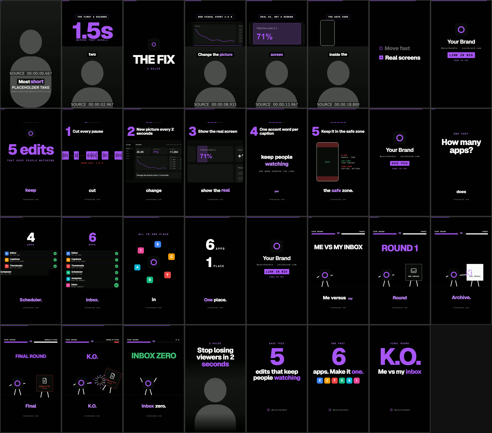

# Remotion starter kit

A working Remotion project for vertical short-form video (1080x1920, 30 fps). It has four sample videos, a set of cover stills and a kit of reusable components. Everything is styled from the shared brand kit in `brand/brand.json` at the repo root, so swapping in your own colours, fonts, logo and call to action restyles every composition at once.



## What is in it

| Composition | What it is |
| --- | --- |
| `TalkingHead` | A recorded take, cut for silences, that switches beat by beat between three layouts: **face** (take fills the frame), **split** (graphic on top, take below, soft seam) and **full** (graphic only). Graphics include a countdown, a big slam word, a screenshot with a camera move and a highlight mark, a spoken word stack and an end card. Captions show one accent word at a time and every cut gets a quiet tick. |
| `Listicle` | "5 edits that keep people watching": a giant step number and title per item, progress dots, and each step shown on a screen (screenshot with camera moves, quick cuts, highlight marks). |
| `Counter` | A number climbs as each item is named, logos orbit your logo, then the payoff lands as three stat lines. |
| `GameParody` | Your logo fights a chore (an inbox) round by round: health bars, hits with impact bursts, round banners and a K.O. |
| `CoverTalkingHead`, `CoverListicle`, `CoverCounter`, `CoverGameParody` | Cover stills, one per video, with the title inside the profile-grid crop. |

The sample videos run on placeholder media that `scripts/make-assets.py` generates: a placeholder take with a burned-in source timecode (so you can see the silence cuts), a sample UI screenshot, letter-tile placeholder logos and synthesized sound effects. Nothing in `public/` is copied from a third party.

## Quick start

```bash
cd starters/remotion-kit
npm install
npm run studio                                   # opens Remotion Studio in the browser
npm run render -- TalkingHead out/talking-head.mp4
npm run still -- CoverListicle out/cover-listicle.png
npm run still -- Listicle out/frame.png --frame=200   # any single frame of a video
npm run preview                                  # renders sample frames of everything into preview.jpg
```

`npm run studio`, `render` and `still` first run `npm run brand`, which copies your logo into `public/brand/`. Rendering loads the brand fonts from `brand.fonts.googleFontsUrl`, so it needs a network connection; offline it falls back to system fonts.

To regenerate the placeholder media (for example after changing brand colours): `npm run assets`. It needs Python 3 with Pillow and ffmpeg.

In the studio, set the `showSafeZone` prop to `true` on any composition to shade the areas platform UI will cover.

## How the brand kit is wired

`src/theme.ts` imports `../../brand/brand.json` (seen from this folder) directly at build time. Nothing is copied by hand: edit `brand.json`, and the next studio reload or render uses the new values. The theme exposes:

- `T`: colours (`bg`, `card`, `line`, `ink`, `muted`, `accent`, `accentStrong`, `accentSoft`, `success`, `danger`, plus a few alpha variants).
- `FONT_HEAD`, `FONT_BODY`, `FONT_MONO` from `brand.fonts`.
- `BRAND` for the name, handle, URL and CTA used by `EndCard`, `Footer` and the covers.
- `SAFE` from `brand.safeZone` (top 240, bottom 1680 on 1080x1920).

The logo is the only file that is copied, because `staticFile()` can only read from `public/`. If you move this starter out of the repo, copy `brand.json` and your logo next to it and update the import path in `src/theme.ts` and the paths in `scripts/sync-brand.mjs`.

## How beats key to spoken words

Every visual starts on a spoken word, never on a hand-typed time. `src/words.ts` gives you:

```ts
import wordsJson from '../../public/words/listicle.json';
import {loadWords, makeAt} from '../words';

const words = loadWords(wordsJson, 'listicle.json'); // checks the shape: [{w, s, e}, ...]
const at = makeAt(words, 'listicle.json');

at('Three');      // start time in seconds of the first "Three"
at('every', 2);   // the second time "every" is said
```

Matching ignores case and punctuation ("That's" matches "thats", "K.O." still matches). If a word is never said, or said fewer times than you asked for, `at()` throws and the render stops with a message such as `at("every", 3): it is only said 2 time(s) in listicle.json`. That is on purpose: a wrong cue fails loudly instead of drifting out of sync. When you re-cut the take or re-record the voiceover, transcribe again and every beat follows the words.

In `TalkingHead`, beats are a list:

```ts
const BEATS: Beat[] = [
  {t: 0, mode: 'face'},
  {t: at('fix'), mode: 'full', render: ({start}) => <BigWord text="THE FIX" at={start} />},
  {t: at('Show'), mode: 'split', render: ({start, end}) => <Panel ...><Shot ... /></Panel>},
];
checkBeats(BEATS); // throws if a beat is not after the one before it
```

`render` gets the beat's `start` and `end` (the next beat's time), so camera moves and animations can fill exactly the time the beat is on screen.

To lay out beats before you have a recording, estimate word times from a script:

```bash
python3 scripts/words_from_script.py "Five edits that keep people watching. One: cut every pause." public/words/draft.json
```

Replace the file with a real transcript once you record; nothing else changes.

## Use your own footage

1. Make an H.264 proxy. iPhone HEVC footage can crash Remotion, and this also lifts dark footage a little (drop the `eq` filter if yours is already bright):

   ```bash
   ffmpeg -i take.mov -vf "eq=gamma=1.35:contrast=1.08,format=yuv420p" -c:v libx264 -crf 18 -r 30 -c:a aac public/video/take.mp4
   ```

2. Transcribe with word times: `python3 ../../tools/transcribe.py public/video/take.mp4 public/words/talking-head.raw.json` (needs faster-whisper).
3. Cut the silences: `python3 ../../tools/cuts.py public/words/talking-head.raw.json public/words/talking-head.edit.json 0.5`. This writes the segments to keep and retimes every word to the edited video. The last argument is the longest pause to keep, in seconds.
4. Edit `BEATS` in `src/compositions/TalkingHead.tsx` to match your script. `faceY` on `ModeEdit` sets how high your face sits in split mode.
5. Put screenshots in `public/shots/` (capture at 2x) and logos in `public/logos/`. Measure rectangles for `Shot` camera moves and marks in the image's own pixels.
6. Render, then normalize loudness for TikTok, Reels and Shorts:

   ```bash
   npm run render -- TalkingHead out/talking-head.mp4
   ffmpeg -i out/talking-head.mp4 -c:v copy -af "loudnorm=I=-14:TP=-1.5:LRA=11" -c:a aac -b:a 192k out/talking-head-final.mp4
   ```

   (`../../tools/loudnorm.sh` does the same.)

For the voiceover videos (`Listicle`, `Counter`, `GameParody`), put your audio in `public/audio/`, transcribe it into the matching `public/words/*.json`, and add `<Audio src={staticFile('audio/your-file.mp3')} />` to the composition.

## The kit

All components live in `src/kit/` and are exported from `src/kit/index.ts`. Every time prop is in seconds on the composition timeline.

| File | Components |
| --- | --- |
| `time.tsx` | `usePop`, `useT`, `During` (show children between two times), `assertOrdered`, `indexAt`, easing helpers |
| `Captions.tsx` | `Captions`: word-by-word, one accent word on screen. Words in `accentWords` stay accented for their whole chunk; otherwise the word being spoken is the accent. `look="outline"` or `"box"`. |
| `text.tsx` | `Label`, `Tag`, `Slam`, `BigWord`, `WordStack`, `Banner` |
| `media.tsx` | `Panel`, `Shot` (screenshot with a camera move from one rect to another and sweeping highlight `marks`), `Clip` (same for video), `useCamera`, `Marks` |
| `numbers.tsx` | `BigNumber`, `StepCounter` (steps up on each cue), `CountUp` (rolls between values), `StatLine` |
| `steps.tsx` | `StepHeader`, `StepDots` |
| `Orbit.tsx` | `Orbit`: logos fly out and circle a centre piece |
| `sfx.tsx` | `Sfx` (one sound at a time) and `CutTicks` (a tick on every cut, rotating three pitches, with heavier hits on chosen cuts) |
| `layout.tsx` | `ModeEdit` (take plus graphics for face, split and full modes), `Beat`, `checkBeats`, `useBeat`, `captionTopFor`, `straightEdit` |
| `fight.tsx` | `Fighter`, `Chore`, `Hud`, `healthAt`, `Burst` |
| `frame.tsx` | `ProgressBar`, `Footer`, `SafeZoneGuide` |
| `EndCard.tsx` | `EndCard` from `brand.json` |
| `icons.tsx` | `Check`, `Arrow`, `Glyph` line icons |

`src/compositions/demo-graphics.tsx` holds graphics that only illustrate the sample scripts (safe zone diagram, pause cutter, caption demo). Replace them with your own.

## Lessons that hold up

- **A new visual every 1 to 2 seconds.** A cut, a camera move to a new spot, a new graphic or a layout switch. If the sheet from `npm run preview` shows two frames in a row that look the same, add a beat.
- **Give each animation about 2 seconds.** Faster than that and nobody reads it; slower and the frame goes still. Key the beat to the word that starts the idea, not the word that ends it.
- **Real logos and real UI over redrawn ones.** Screenshot the actual product at 2x and move a camera over it. Viewers trust what they recognise; a redrawn mock looks like an ad.
- **Nothing important outside the safe zone.** Platform UI covers the top 240 px and everything below 1680 px. Titles, captions, numbers and faces go between those lines; turn on `showSafeZone` to check.
- **One accent word per caption.** Pick the word that carries the line. Colouring several words means none stand out.
- **Say the call to action out loud.** The end card backs it up; it does not replace it.

## Files

```
starters/remotion-kit/
  package.json, tsconfig.json, remotion.config.ts
  src/index.ts, src/Root.tsx      entry point and composition list
  src/theme.ts                    theme built from brand/brand.json
  src/fonts.ts                    loads the brand fonts before rendering
  src/words.ts                    at(), word list and edit loaders, caption chunking
  src/kit/                        reusable components
  src/compositions/               TalkingHead, Listicle, Counter, GameParody, Cover
  public/words/                   sample word lists and the talking-head edit
  public/video/                   placeholder take and a cover frame
  public/shots/, public/logos/    sample screenshot and placeholder logos
  public/sfx/                     synthesized ticks, whoosh, slam, hit, pop
  scripts/make-assets.py          regenerates everything in public/
  scripts/words_from_script.py    estimated word times from a script
  scripts/sync-brand.mjs          copies the brand logo into public/brand/
  scripts/preview.mjs             renders sample frames into preview.jpg
```

`node_modules/`, `out/` and `public/brand/` are ignored by git.
